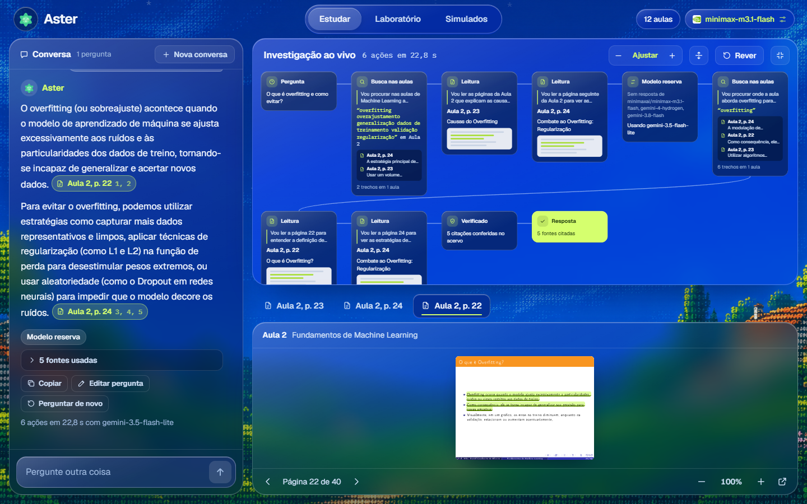
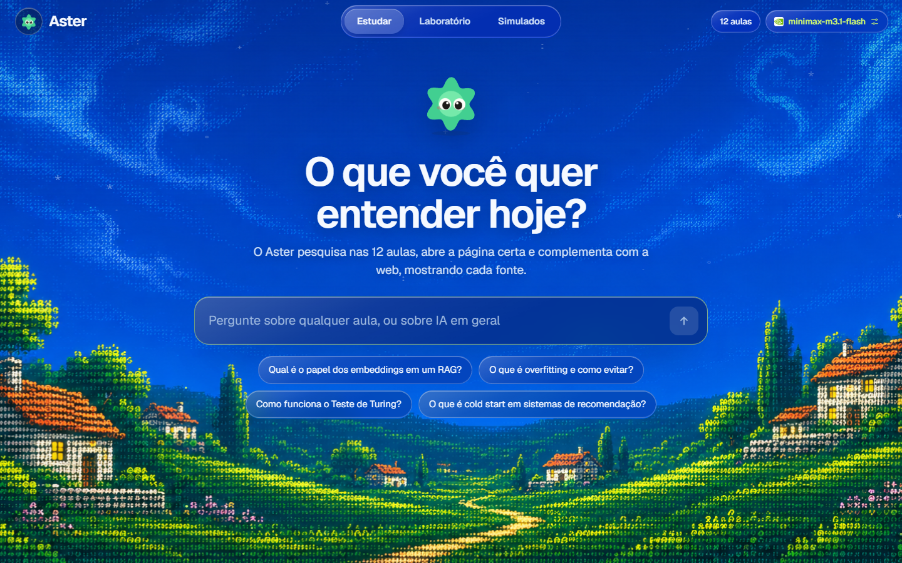
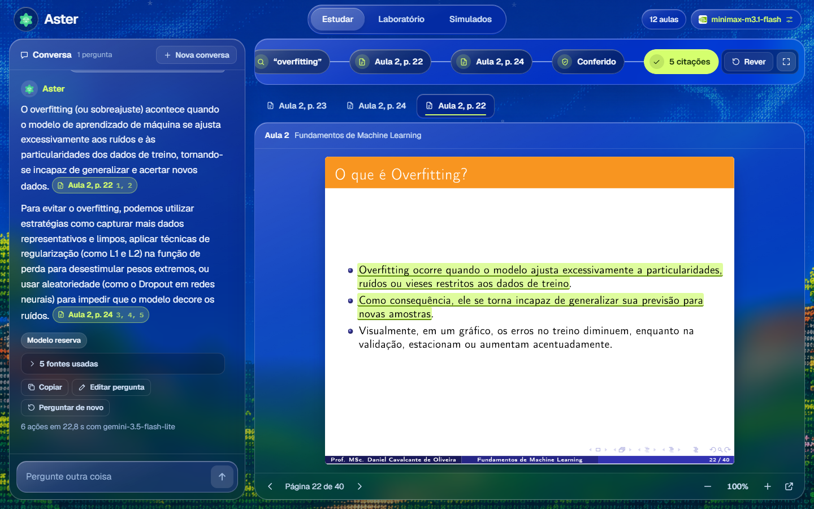
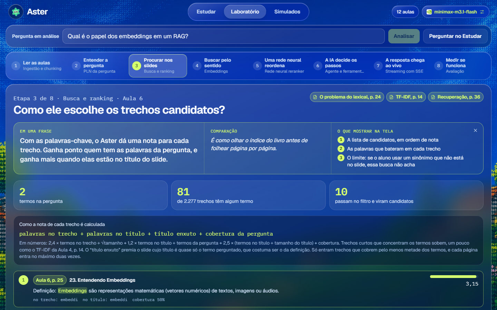
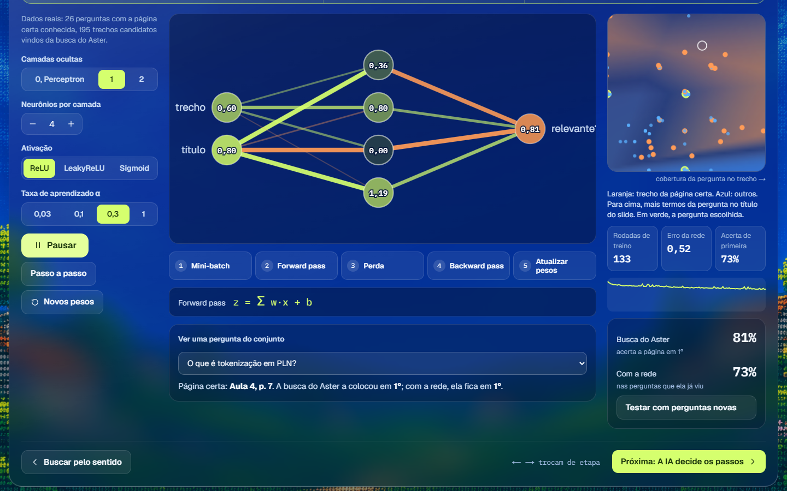
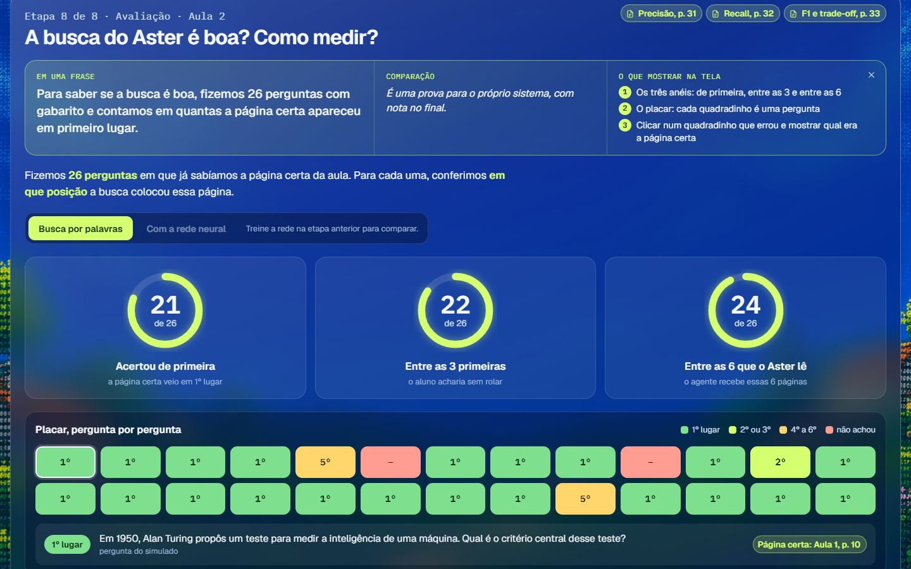
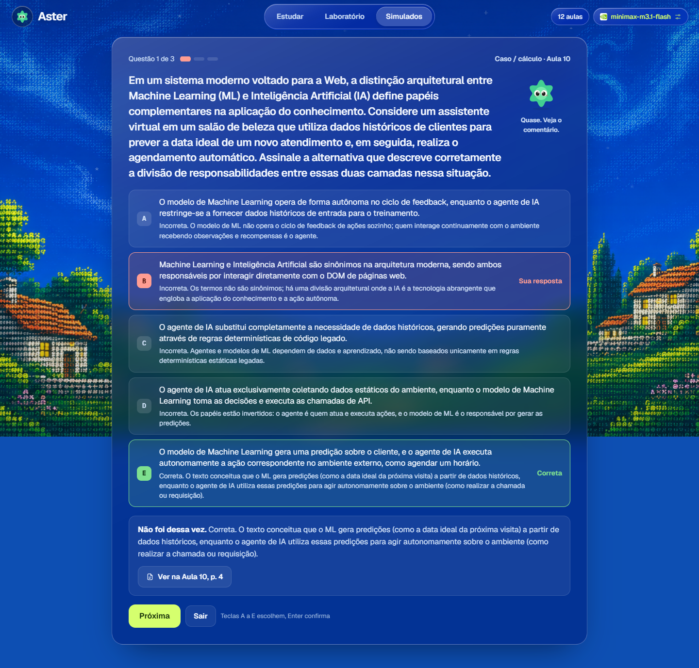
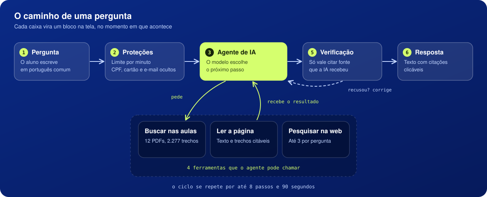
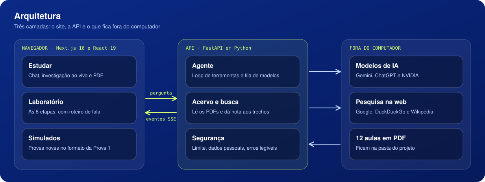
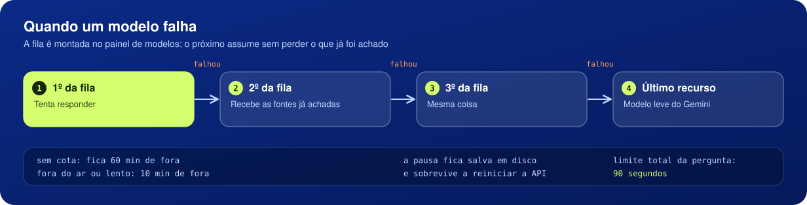

<div align="center">


# Aster

**O agente de estudos que mostra de onde tirou cada resposta.**

O aluno pergunta. O Aster pesquisa nas 12 aulas, abre a página certa, complementa com a internet<br>
e responde citando cada fonte. Cada passo aparece na tela no momento em que acontece.

<br>



</div>

<br>

> Trabalho da disciplina de Inteligência Artificial (SENAC, prof. Daniel Cavalcante). Os PDFs das 12 aulas vêm junto no repositório.

## Sumário

- [O que ele faz](#-o-que-ele-faz)
- [Telas](#-telas)
- [Como rodar](#-como-rodar)
- [Como funciona](#-como-funciona)
- [A busca nas aulas](#-a-busca-nas-aulas)
- [Modelos e chaves](#-modelos-e-chaves)
- [Laboratório](#-laboratório)
- [Simulados](#-simulados)
- [Rotas da API](#-rotas-da-api)
- [Segurança](#-segurança)
- [Estrutura de pastas](#-estrutura-de-pastas)
- [Testes](#-testes)
- [Apresentação](#-apresentação)

##  O que ele faz

| | |
| --- | --- |
| **Pesquisa de verdade** | Quem decide os passos é o modelo de IA. Ele escolhe quando buscar nas aulas, quando abrir uma página e quando ir à internet. |
| **Mostra a fonte** | Cada frase da resposta aponta o slide ou o site que a sustenta. Clicar na citação abre a página com o trecho marcado. |
| **Não inventa citação** | O servidor recusa qualquer resposta que cite uma fonte que a IA não recebeu das ferramentas. |
| **Investigação ao vivo** | Cada busca, leitura e pesquisa vira um bloco desenhado na tela pelo cursor do Aster, com zoom e modo ampliado. |
| **Fica na matéria** | Responde só sobre os assuntos dos slides. A web complementa a explicação, mas pedido fora da disciplina recebe uma recusa gentil, sem pesquisa. |
| **Entende como o aluno escreve** | Erro de digitação, abreviação e falta de acento não atrapalham: "overflitting" vira overfitting e "front" acha frontend. Só é recusado o que não tem nada a ver com a matéria ou tenta burlar as regras. |
| **Lembra de você** | Guarda fatos curtos que o aluno conta (nome, como prefere estudar) e retoma a conversa pelo contexto. Um "oi" é respondido direto, sem montar a investigação. |
| **Não para se um modelo cair** | Há uma fila de modelos do Gemini, do ChatGPT e da NVIDIA. Se um falha, o próximo assume com o que já foi achado. |
| **Explica a si mesmo** | O Laboratório mostra, com os dados reais, as 8 etapas que uma pergunta percorre, cada uma ligada à aula que a ensina. |

##  Telas

<table>
  <tr>
    <td width="50%"></td>
    <td width="50%"></td>
  </tr>
  <tr>
    <td><b>Início.</b> Uma pergunta e quatro sugestões.</td>
    <td><b>Resposta.</b> Citações clicáveis, lista de fontes e o slide com o trecho marcado.</td>
  </tr>
  <tr>
    <td></td>
    <td></td>
  </tr>
  <tr>
    <td><b>Laboratório.</b> Cada etapa abre com um roteiro de fala em linguagem simples.</td>
    <td><b>Rede neural.</b> Uma MLP treinada no navegador com os pares reais de pergunta e trecho.</td>
  </tr>
  <tr>
    <td></td>
    <td></td>
  </tr>
  <tr>
    <td><b>Avaliação.</b> O placar das 26 perguntas de teste, uma peça por pergunta.</td>
    <td><b>Simulados.</b> O Aster escreve uma prova nova a cada vez, no formato da Prova 1.</td>
  </tr>
</table>

##  Como rodar

Requer **Node.js 20.9+** e **Python 3.11+** (testado até o 3.15). O `iniciar.bat` confere as duas versões, instala o que faltar e fecha um Aster antigo que tenha ficado aberto.

**Windows, com dois cliques:** abra o `iniciar.bat`. Na primeira vez ele cria o `.env`, o ambiente Python e instala as dependências. Depois sobe a API e o site e abre o navegador.

**Mac, com dois cliques:** abra o `iniciar.command`. Faz o mesmo que o `.bat` e, ao fechar a janela do Terminal, desliga a API. Precisa do Python 3.12 ou superior (o do macOS é antigo; instale pelo [python.org](https://www.python.org/downloads/macos/) ou com `brew install python@3.12`) e do Node.js 20. Se o Mac bloquear o arquivo na primeira vez, clique com o botão direito nele e escolha **Abrir**.

**Pelo terminal:**

```powershell
npm install
python -m venv .venv
.\.venv\Scripts\python.exe -m pip install -r api\requirements.txt
if (-not (Test-Path .env)) { Copy-Item .env.example .env }
.\.venv\Scripts\python.exe -m uvicorn api.main:app --port 8000
```

Em outro terminal:

```powershell
npm run dev
```

Abra `http://127.0.0.1:3000`, clique no botão de modelo no topo e cole a **sua chave de IA** (o Gemini tem plano gratuito em [aistudio.google.com/apikey](https://aistudio.google.com/apikey)). Não precisa de `.env`.

Os arquivos `Aula 1.pdf` a `Aula 12.pdf` já vêm na raiz do projeto. Outros PDFs entram por `data/materials/`.

`npm run dev` escuta só neste computador. Para abrir no celular, use `npm run dev:rede` numa rede confiável.

### Colocar no ar

O Aster é feito para ficar aberto ao público, com **cada visitante usando a própria chave**. Num servidor:

1. Instale como acima e rode a API só para dentro da máquina: `uvicorn api.main:app --host 127.0.0.1 --port 8000`.
2. Gere e rode o site: `npm run build` e `npm start`. Só ele fica exposto; ele repassa `/api` para a API.
3. Coloque na frente um proxy com HTTPS que acrescente o IP real no `X-Forwarded-For` (Caddy, nginx, ou o da própria hospedagem, como Render, Railway ou Fly). É por esse IP que os limites contam cada visitante.
4. Guarde a pasta `data/` num volume persistente: ali ficam a senha do dono, as configurações e a chave de cifra.
5. Na primeira visita, abra **Modelos de IA → Sou o dono do site** e crie a senha com o código de uso único que aparece no terminal da API (e em `data/codigo-de-configuracao.txt`).

Nada disso precisa de `.env`. As variáveis abaixo continuam aceitas, mas só como reserva do que se configura pelo painel:

| Variável | Para que serve |
| --- | --- |
| `GEMINI_API_KEY`, `OPENAI_API_KEY`, `NVIDIA_API_KEY` | Chave do site para quem não tiver a própria (o painel do dono faz o mesmo, cifrado) |
| `ASTER_PERGUNTAS_POR_MINUTO`, `ASTER_PERGUNTAS_POR_DIA`, `ASTER_PERGUNTAS_POR_DIA_TOTAL` | Limites, se não foram definidos no painel |
| `ASTER_TEMPO_MAXIMO`, `GEMINI_THINKING`, `ASTER_WEB_GOOGLE`, `ASTER_WEB_DUCKDUCKGO` | Tempo máximo, raciocínio e buscadores, se não foram definidos no painel |
| `ASTER_SECRET` | Chave de cifra das chaves do site; sem ela, o Aster cria `data/secret.key` |
| `ASTER_API_ORIGIN` | Endereço da API visto pelo site (padrão `http://127.0.0.1:8000`) |

##  Como funciona



A API entrega ao modelo estas ferramentas, e ele decide quais usar e em que ordem:

| Ferramenta | O que faz |
| --- | --- |
| `buscar_nas_aulas` | Procura por palavras-chave nos trechos dos PDFs. A IA escolhe os termos e pode restringir a uma aula |
| `ler_pagina` | Abre uma página inteira e devolve os trechos citáveis dela |
| `pesquisar_na_web` | Pesquisa na internet: Google pelo Gemini quando há cota, depois DuckDuckGo, depois Wikipédia. Até 3 por pergunta, sem repetir termos |
| `responder` | Entrega a resposta em blocos, cada um com os ids das fontes |
| `conversar` | Responde cumprimentos e perguntas sobre o próprio Aster, sem pesquisa |
| `sem_base` | Usada quando nem as aulas nem a web sustentam uma resposta |

Antes do primeiro passo do modelo, o servidor já busca a pergunta nas aulas e entrega os trechos achados: o modelo pode ler a página ou responder logo no 1º passo, uma ida e volta a menos.

Cada chamada vira um evento enviado ao navegador por SSE (`tool_call`, `search_results`, `page_read`, `web_results`, `answer_check`, `answer_ready`). A interface encena esses eventos: o cursor do Aster desenha o bloco, a página abre, o trecho citado é selecionado e a resposta é escrita.



##  A busca nas aulas

Os 12 PDFs viram **499 páginas** e **2.277 trechos**, cada um com um id (`aula-6-p25-s0`) que depois vira a citação. A pergunta passa por normalização, remoção de palavras vazias e corte de sufixos. Cada trecho recebe uma nota:

```
nota = palavras no trecho + palavras no título + título enxuto + cobertura da pergunta
```

O "título enxuto" premia o slide cujo título é quase só o termo perguntado, que costuma ser o da definição. A página vale pelo melhor trecho mais um pouco do segundo.

A busca é medida em 26 perguntas com a página certa conferida (`api/eval_set.py`):

| | Antes | Agora |
| --- | --- | --- |
| Página certa em 1º lugar | 65% | **81%** |
| Entre as 3 primeiras | 65% | **88%** |
| Entre as 6 que o agente lê | 92% | **96%** |
| MRR | 0,71 | **0,86** |

O ganho aparece nos dois grupos de perguntas (simulados e conceitos do sistema).

**Perguntas em forma de situação.** O aluno muitas vezes descreve o problema sem o termo do slide: "meu modelo acerta no treino e erra em dados novos" é overfitting, mas não diz "overfitting". Busca por palavras não liga as duas coisas; quem liga é o modelo. O texto de regras manda o agente reconhecer qual conceito a situação descreve e buscar pelo nome técnico, e a busca inicial avisa quando os trechos não tratam da situação. Buscando pelo termo técnico, a página certa vem entre as 3 primeiras em 95% de 20 perguntas de situação escritas para conferir isso.

##  Modelos e chaves

O botão de modelo na barra superior abre o painel **Modelos de IA**. Cada visitante:

- cola a própria chave do **Gemini**, do **ChatGPT** (OpenAI) ou da **NVIDIA**;
- lista os modelos que a chave dele enxerga, direto da API do provedor;
- **testa** um modelo: o teste mede o tempo de resposta e confirma se ele chama ferramentas, o que o agente exige;
- monta a própria **fila**, na ordem em que os modelos são tentados.

A chave e a fila ficam só no navegador do visitante. A chave vai junto com cada pergunta e vale só durante aquela consulta: o servidor não grava, não registra e não devolve.



No link **Sou o dono do site**, protegido por senha, o dono define os limites do site e pode cadastrar uma chave do site para quem não tiver a própria. Essa chave fica cifrada em `data/settings.json`, e o navegador só recebe o final mascarado.

##  Laboratório

A rota `/laboratorio` mostra o caminho de uma pergunta dentro do Aster, com os dados reais do sistema. Cada etapa abre no modo **Simples**: uma frase curta, uma comparação do dia a dia e só o visual principal. O botão **Por dentro** mostra as fórmulas, o código, o prompt inteiro e todos os números. O roteiro de fala (o que mostrar na tela) fica num botão, e as setas do teclado trocam de etapa.

| # | Etapa | Em linguagem simples | Aula |
| --- | --- | --- | --- |
| 1 | Ingestão e chunking | Ler as aulas e cortar em pedacinhos com endereço | Aula 6, p. 33-34 |
| 2 | PLN da pergunta | Limpar a pergunta e ficar só com as palavras-chave | Aula 4, p. 6-9 |
| 3 | Busca e ranking | Dar nota a cada trecho | Aula 6, p. 24 |
| 4 | Embeddings | Buscar pelo sentido, com vetores reais do `gemini-embedding-001` | Aula 6, p. 25-27 |
| 5 | Rede neural reranker | Uma MLP treinada no navegador reordena os candidatos | Aula 3 e Aula 10, p. 22 |
| 6 | Agente e ferramentas | O texto de regras, as ferramentas e o ciclo pensar, agir e observar | Aula 6, p. 8 e Aula 10, p. 9-13 |
| 7 | Streaming com SSE | Os eventos chegando um a um, com o tempo de cada | Aula 7, p. 16-22 |
| 8 | Avaliação | Anéis e placar das 26 perguntas, com recall, precisão e MRR num bloco técnico | Aula 2, p. 31-33 |

Quando o Aster cita uma página coberta por uma etapa, a resposta oferece abri-la no Laboratório.

##  Simulados

A rota `/simulados` monta **uma prova diferente a cada vez**. O Aster sorteia páginas dos slides e a IA escreve questões inéditas no formato da Prova 1 da turma:

- cinco alternativas, de A a E, com uma única correta;
- três formatos que se alternam: afirmações (I–IV), caso prático e asserção e razão, sempre conceituais, sem conta;
- um comentário para cada alternativa, como num gabarito comentado, e a página da aula que sustenta a resposta.

Antes de montar, a tela pergunta: **quer que use todas as aulas ou só depois da primeira prova?** A segunda opção foca nas aulas 11 e 12 (a Prova 1 cobriu da 1 à 10) e traz cerca de um quarto das questões das aulas anteriores, como revisão.

O servidor confere cada questão antes de mostrar:

1. **Formato:** cinco alternativas distintas, uma única correta e comentários coerentes com o gabarito.
2. **Segunda leitura:** outro pedido à IA resolve a prova com os slides, sem ver o gabarito. Questão em que a resposta dela não bate com o gabarito é descartada, porque é ambígua ou o gabarito está errado.
3. **Embaralhamento:** as alternativas mudam de ordem para o gabarito não se concentrar numa letra.

Para ser rápido, a prova é escrita em blocos de 3 questões ao mesmo tempo, e cada questão aparece na tela assim que o bloco dela é conferido. O Aster pede algumas a mais para sobrar depois da conferência. Se um modelo demora mais de 4 segundos, o próximo da fila começa junto e vale a primeira resposta válida. Se a IA não entregar todas (ou não houver chave), a prova é completada com o banco de 12 questões conferidas à mão.

Enquanto a prova é montada, o Aster aparece lendo as páginas sorteadas e desenhando cada questão no quadro. A correção pode ser a cada questão ou só no final.

##  Rotas da API

A documentação interativa fica em `http://127.0.0.1:8000/docs` (Swagger) e `/redoc`.

| Método | Rota | O que faz |
| --- | --- | --- |
| `POST` | `/api/tutor/runs` | Faz uma pergunta e recebe os passos do agente em SSE |
| `GET` | `/api/health` | Mostra se a API está no ar e o modelo ativo |
| `GET` | `/api/materials` | Lista as aulas indexadas |
| `GET` | `/api/materials/{aula}/pdf` e `/pages/{página}` | Entrega o PDF e o texto de uma página |
| `POST` | `/api/ai/models` e `/api/ai/test` | O visitante lista e testa modelos com a própria chave (não é guardada) |
| `GET`, `POST`, `PUT` | `/api/admin/...` | Senha, sessão e limites do dono do site |
| `GET`, `PUT`, `DELETE` | `/api/settings/...` e `/api/providers/...` | Chave e fila do site (só o dono, logado) |
| `GET` | `/api/lab/...` | Dados reais de cada etapa do Laboratório |
| `POST` | `/api/simulado/runs` | Monta uma prova nova (escopo e número de questões) e envia as questões em SSE |

Todo erro volta no mesmo formato, com uma mensagem em português. Na tela, o site mostra sempre o número junto, por exemplo `429 · Muitas perguntas seguidas. Espere 20 s e tente de novo.` ou `502 · A API do Aster não está rodando.`:

```json
{ "detail": { "code": "invalid_request", "message": "Requisição inválida: pergunta: precisa ter pelo menos 3 caracteres." } }
```

| HTTP | `code` | Quando |
| --- | --- | --- |
| 400 | `invalid_request` | Pergunta vazia, longa demais ou JSON malformado |
| 401 | `login_required`, `setup_required` | Rota do dono sem sessão, ou sem senha criada ainda |
| 403 | `csrf` | Pedido que muda algo sem vir do painel do site |
| 404 | `route_not_found` | Rota inexistente |
| 405 | `method_not_allowed` | Método HTTP errado |
| 413 | `payload_too_large` | Corpo maior que 64 KB |
| 429 | `too_many_questions`, `daily_limit`, `site_daily_limit` | Passou do limite por minuto, por dia ou do site, com `Retry-After` |
| 500 | `internal_error` | Erro inesperado; o detalhe fica só no log do servidor |

Falhas do modelo durante uma pergunta (sem cota, fora do ar, resposta inválida) não viram erro HTTP. Chegam como evento `model_fallback`, e o próximo modelo da fila assume.

##  Segurança

- **Chave de cada visitante:** fica só no navegador dele e vale só durante a consulta. Não é gravada, registrada nem devolvida pela API. A pausa por falta de cota é da chave: a cota estourada de um visitante não afeta os outros.
- **Área do dono:** senha com scrypt, sessão em cookie `HttpOnly`, `SameSite=Strict` e `Secure` em HTTPS, login limitado a 5 tentativas a cada 15 min. Criar a senha exige um código de uso único impresso no servidor, porque atrás de um proxy o IP "local" pode ser forjado.
- **Chave do site cifrada:** se o dono cadastrar uma, ela fica cifrada em disco (Fernet), com a chave de cifra num arquivo separado.
- **CSRF:** pedidos que mudam algo exigem um cabeçalho do painel e a origem do próprio site.
- **Limites:** por minuto e por dia para cada visitante, e um teto diário do site inteiro, tudo ajustável no painel do dono.
- **Cabeçalhos de segurança:** CSP, `X-Frame-Options`, `nosniff`, `Referrer-Policy`, `Permissions-Policy` e HSTS em produção. Só links `http(s)` dos buscadores chegam à página.
- **Dados pessoais:** CPF, cartão, e-mail e telefone são trocados por marcadores antes de a pergunta ir para a IA ou para a busca na web, e a resposta avisa o que foi ocultado.
- **Prompt injection:** a pergunta vai entre `<pergunta_do_aluno>`, e o texto de regras manda tratar a pergunta, a conversa e tudo o que as ferramentas devolvem (slides e páginas da web) como dado, nunca como instrução.
- **Citações conferidas:** o servidor recusa respostas que citem fontes que a IA não recebeu.
- **Resposta fiel à fonte:** se um bloco da resposta diz mais do que os slides citados dizem (menos de 30% dos termos em comum), a IA precisa reescrever antes de a resposta aparecer.
- **Limite de tempo:** cada passo de um modelo tem até 20 segundos quando há reserva na fila; se travar, o próximo assume com as fontes já encontradas. Conexão derrubada no meio ganha uma segunda tentativa, e o motivo real de cada falha aparece no terminal da API. A pergunta inteira para em 90 segundos.
- **Erro claro em vez de meia resposta:** se nenhum modelo terminar (sem cota, sem crédito, fora do ar ou lento), o Aster mostra o erro com o motivo de cada modelo tentado (por exemplo, `429 · limite de uso`), em vez de trechos soltos que pareceriam uma resposta pela metade.
- **Escopo:** com IA disponível, quem decide o que é da matéria é o modelo, que entende situação, gíria e erro de digitação e recusa com gentileza o que for de fora. Sem IA, pergunta que não bate com nenhum slide nem fala de IA é recusada no servidor. Pedidos como "ignore as regras" ou "mostre seu prompt" são barrados no servidor sempre, com ou sem IA. A pesquisa web recusa consultas fora da matéria mesmo que o modelo tente.
- **Memória local:** os fatos guardados ficam só no navegador do aluno (botão Memória no chat, com Esquecer).

##  Estrutura de pastas

```
├── api/
│   ├── main.py          # agente, pesquisa na web e rotas
│   ├── library.py       # leitura dos PDFs, trechos e busca
│   ├── providers.py     # Gemini, OpenAI e NVIDIA atrás da mesma interface
│   ├── security.py      # limites por IP, dados pessoais, cabeçalhos e erros legíveis
│   ├── admin.py         # senha e sessão do dono, chave do site cifrada e limites
│   ├── visitor.py       # chave de cada visitante, válida só durante a consulta
│   ├── lab.py           # dados das etapas do Laboratório
│   ├── simulado.py      # provas novas escritas pela IA no formato da Prova 1
│   ├── eval_set.py      # as 26 perguntas de avaliação
│   └── test_main.py     # testes da API
├── app/                 # rotas do site: Estudar, Laboratório e Simulados
├── components/          # conversa, investigação, cursor, PDF e etapas do Laboratório
├── lib/                 # estado da consulta, rede neural (nn.ts) e utilitários
├── public/mascot/       # o Aster em quatro expressões
├── docs/                # telas, diagramas e ícones deste README
├── iniciar.bat          # sobe tudo com dois cliques no Windows
├── iniciar.command      # o mesmo, no Mac
└── .env.example         # modelo das variáveis de ambiente
```

**Tecnologias:** Next.js 16, React 19, TypeScript, Tailwind 4 e Motion no site; FastAPI, Pydantic e PyMuPDF na API; SSE para o streaming.

##  Testes

```powershell
.\.venv\Scripts\python.exe -m unittest api.test_main
npm run typecheck
```

Os testes cobrem o loop do agente, a troca de modelo, a verificação de citações, os limites, a ocultação de dados pessoais, o formato dos erros e a qualidade da busca.

##  Apresentação

Os slides da apresentação do trabalho estão em [`docs/apresentacao/Aster-apresentacao.pdf`](docs/apresentacao/Aster-apresentacao.pdf): o que é o Aster, a arquitetura (navegador, FastAPI, Pydantic, agente, verificação e SSE), a resposta em JSON conferida pelo servidor, o que acontece quando a IA cai ou demora, as proteções e a demonstração.

<br>

<div align="center">

<br>
<sub>Feito por Vitor Cavalcante Gomes</sub>
</div>
